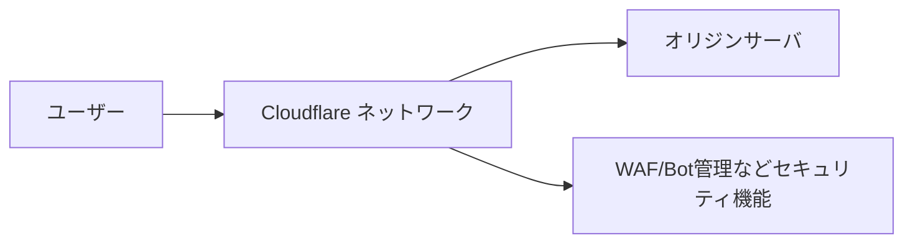
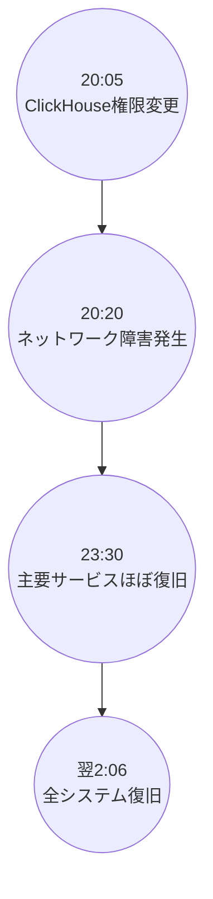

# 2025年11月18日 Cloudflare大規模障害 調査報告

## エグゼクティブサマリ 
2025年11月18日夜（日本時間）、Cloudflareネットワークで重大な障害が発生し、多数のWebサービス（OpenAI/ChatGPT、Zoom、X、Spotify、Canvaなど）が一時的に利用不能となりました。原因は、同社のBot管理システム向けの内部構成ファイル（フィーチャー設定ファイル）を生成するクエリが、事前の権限変更により重複データを出力しファイルサイズが想定外に倍増したことでした。肥大化したファイルは全ネットワークに急速に伝播し、コアプロキシ（Frontline）がメモリ上限を超えて停止したため、HTTP 5xxエラーが多発しサービス停止に至りました。Cloudflareは障害発覚後すぐに問題の設定ファイル配布を停止し、既知の正常版へ切り替える対応を実施、23時30分頃までに主要トラフィックは復旧、翌19日2時06分に全システムが正常稼働に戻りました。応急措置では、問題発生プロセスの停止や既存セッションへの影響緩和（Workers KV/Accessの旧プロキシ迂回）などが行われました。再発防止策としては、内部生成ファイルの厳格検証、機能単位のキルスイッチ強化、ログ処理最適化などが検討されています。本報告では、Cloudflareのサービス概要から障害発生の技術的原因、影響範囲、対応措置、恒久対策、教訓までを詳細に整理します。

## クラウドフレアとは（会社概要・サービス・仕組み）
**目的**: Cloudflareの基本情報と提供サービスを理解する  
- **設立・上場**: 2009年創業の米国企業で、2019年にNYSE(NASDAQ)へ上場。  
- **グローバルネットワーク**: 世界125カ国335都市にサーバを展開し、1秒間当たり約1.02億件のHTTPリクエストを処理（Webトラフィックの約20%相当）。  
- **提供サービス**: CDN（コンテンツ配信）やリバースプロキシ、DDoS防御、WAF（Webアプリケーションファイアウォール）、DNS、Bot管理、ゼロトラストセキュリティ、サーバレス（Workers）など多岐に渡るネットワーク・セキュリティ製品を提供。  
- **処理経路**: 全リクエストはまずエッジノードのコアプロキシ（Frontline）に到達し、続いてキャッシュエンジン（Pingora）やオリジンサーバへルーティングされる。  

*図: Cloudflareネットワークの基本処理フロー（リクエストがエッジノードを経由し、オリジンや各種セキュリティ機能へルーティング）*。  

## 事件発生の原因（技術的詳細・タイムライン・根本原因）
**目的**: 障害を引き起こした技術的原因と経緯を解明する  
- **DB設定変更（11/18 20:05）**: CloudflareはClickHouseデータベースのクエリ権限設定を更新した。これによりBot管理システムが使用する「フィーチャー設定ファイル」生成クエリの挙動が変わり、通常は一意なデータを返すべきところ重複データを含むようになった。  
- **設定ファイル肥大化**: 生成されたフィーチャー設定ファイルは、従来の上限（約200行）を超え2倍以上の巨大サイズとなった。Cloudflareコアプロキシにはサイズ上限が設定されており、これを超えるとメモリ安全装置が作動、システムが停止する仕組みであるため、障害が発生した。  
- **伝播と二次障害**: 肥大化したファイルは数分ごとにネットワーク全体へ配信され、当初は正常なファイルが交互に生成されることでシステムが一時的に回復・停止を繰り返す不安定な状況となった。これにより初動調査は混乱し、当初は大規模なDDoS攻撃の疑いも持たれたが、最終的に内部設定ミスと判明した。  
- **障害発生**: 日本時間11月18日20時20分頃、Cloudflareコアネットワークでトラフィック停止が発生し調査開始。HTTP 5xxエラーが急増し、さまざまなサービスに障害が波及した。  

*図: 障害発生から復旧までのタイムライン（JST）。クリックハウス設定変更後、20:20頃から障害発生、23:30にコアトラフィックがほぼ正常化、翌2:06に完全復旧した。*

## 被害・被害範囲（影響サービス・顧客・地域・定量データ）
**目的**: 影響の及んだ範囲と被害内容を明確化する  
- **グローバル影響**: OpenAI/ChatGPTやZoom、X、Spotify、Canvaなど、世界中の主要サービスがこの障害で一斉にアクセス困難となった。Cloudflare利用サイト全般でHTTP 5xxエラーが多発し、ユーザーにはエラーページが表示された。  
- **影響サービス詳細**: Cloudflare自身の内部サービスや顧客向け機能にも波及。以下の表に主な影響内容を示す。

| **サービス/機能**        | **影響内容**                                         |
|:-----------------|:---------------------------------------------|
| **CDN/セキュリティサービス** | ネットワーク全体でHTTP 5xxが多発。エンドユーザーはエラーページが表示された。 |
| **Turnstile認証**       | Turnstile読み込み失敗により、2要素認証やCAPTCHAページでログイン不可に。 |
| **Workers KV**      | コアプロキシ障害でフロントエンドゲートウェイのリクエストが失敗し、5xxエラー急増。 |
| **管理ダッシュボード**   | Turnstile障害とKV障害、さらに復旧後のアクセス集中でログインできないユーザー続出。 |
| **メールセキュリティ**   | メール配信自体は影響なし。ただしIPレピュテーション参照不可でスパム検出精度低下が一時発生。 |
| **Access認証**       | 障害開始～11/18 23:05まで認証失敗が続出（既存セッションは影響なし）。設定変更はロールバック済。 |

*表: 影響を受けた主なCloudflareサービスと現象（Cloudflare公式ブログより要約）。*  

## 応急対策（実施対応・推奨手順）
**目的**: 障害発生時の直近対応と顧客対応指針を整理する  
- **問題ファイル修正**: 問題となったフィーチャーファイルの生成・伝播を停止し、最後に正常だった既知バージョンへ手動差し替えを実施。同時にコアプロキシを強制再起動し、11月18日23:30頃までに主要トラフィックを復旧させた。  
- **内部迂回処置**: 調査中は、Workers KVやAccessなど一部機能を旧プロキシに迂回させてサービス維持を図った。これにより影響範囲を限定し、復旧作業を加速した。  
- **顧客・運用への提言**: 顧客にはCloudflareステータスページや公式連絡を確認し、しばらく待機するよう案内。また、この種の障害対策として、（可能であれば）バックアップルートやキャッシュによる代替配信、二重化された認証手段の準備が推奨される。  

## 恒久対策（再発防止策・設計改善・運用強化）
**目的**: 今後の再発防止・安全対策を検討する  
- **内部検証強化**: ユーザー入力と同様に、内部で自動生成する設定ファイルにも厳格なバリデーション・チェック機構を導入する。  
- **キルスイッチ拡充**: 障害時に機能単位で迅速停止できるキルスイッチ（緊急停止機構）を拡充し、異常な設定や処理の伝播を食い止める仕組みを整える。  
- **ログ/リソース管理**: エラー報告のオーバーヘッドを最小化し、可観測性システムがリソース飽和しないよう最適化する。  
- **変更管理の徹底**: 大規模ネットワークに影響する変更はカナリアリリースや段階的展開を行い、小規模で検証後に全体導入するなど安全策を採る。障害検知用メトリクス（5xxエラー急増、内部APIレスポンス異常など）の監視体制を強化する。  

## まとめ（教訓・今後の監視ポイント）
**目的**: 本件の教訓を整理し、監視・対策重点項目を確認する  
- **設定変更のリスク**: 小さなデータベース設定変更でも、Bot管理のような機械学習系モジュールでは全体停止を招く恐れがある。同様の重要コンポーネントでは事前検証を徹底し、サイズ変化への耐性を持たせることが教訓である。  
- **エラーモニタリング強化**: HTTP 5xxエラーの急増は即時障害の警告とみなし、迅速対応すべき。ダッシュボードや認証系APIの応答遅延・異常も早期検出指標とし、状況変化を自動検知する仕組みが必要である。  
- **監視インフラの独立性**: 本件ではCloudflareのステータスページもダウンし情報取得が困難になった。今後、ステータスや監視ダッシュボードは障害対象外の独立インフラで運用し、常時監視可能な態勢を確保すべきである。  
- **再発防止の徹底**: Cloudflare自身が公表した再発防止策（内部生成ファイルの検証強化、キルスイッチ拡充）を着実に実施するとともに、ユーザ側も災害復旧計画・バックアップ手順の見直しを行い、類似障害への備えを強化することが望まれる。

**参考資料:** Cloudflare公式ブログおよび主要報道の分析。